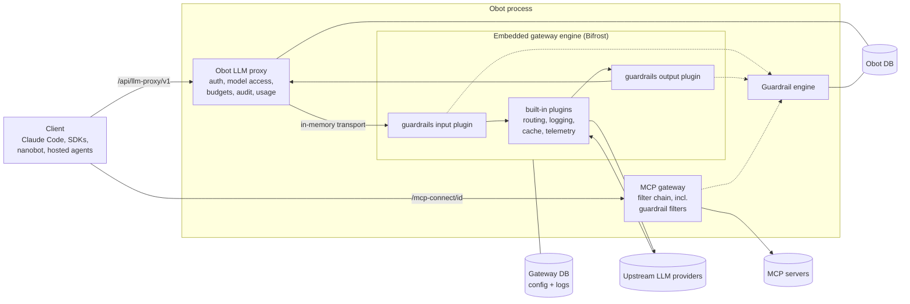
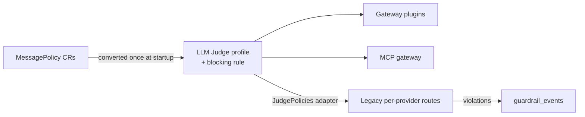

# 2026-09-27: Unified LLM gateway, budgets and guardrails

- **Authors:** Craig Jellick
- **Created:** 2026-09-27

## Summary

Replace Obot's per-provider LLM proxies with one unified LLM gateway. The
gateway engine is [Bifrost](https://github.com/maximhq/bifrost)
(Apache-2.0, Go), embedded in the Obot process as a library. Obot keeps
authentication, model access policies, auditing and usage tracking in front of
the engine. Bifrost handles provider routing, key load balancing, retries,
fallbacks, API-format translation, routing rules, response caching and request
logging. Bifrost is an implementation detail: no Obot path, model ID, header or
metric names it.

Two capabilities that Bifrost only offers in its Enterprise edition are built
into Obot instead:

- **Budgets.** Caps on spend, tokens or requests over rolling or calendar
  windows, per user or shared, assigned to users, groups or everyone. Obot
  enforces them from usage recorded in its own database, so they hold across
  replicas. They replace the daily token quota for gateway traffic.
- **Guardrails.** Detectors that check content, applied to LLM gateway
  traffic (including streamed responses) by guardrail rules, and to MCP traffic
  by a new in-process **guardrail filter** type in the existing MCP filter
  chain. Either can block, redact or log. There are three built-in detectors
  and eight integrations with external guardrail services. Message policies
  become one kind of guardrail.

The gateway is managed from the existing **Models** page (new tabs), a new
**Guardrails** page, and the Usage and Audit Logs pages.

A working prototype exists on the `bifrost-llm-gateway` branch of
`obot-platform/obot`, with ADRs `2026-09-26-embed-bifrost-llm-gateway.md` and
`2026-09-26-guardrails.md`. This proposal describes that prototype so it can be
reviewed before it ships, and lists what it changes in existing behavior.

## Related issues

- TBD. No issue has been filed yet. Per this repository's rules, an issue must
  be linked before the proposal merges.

## Related ODPs

- [2026-09-01: Virtual MCPs](https://github.com/obot-platform/obot-design-proposals/blob/main/proposals/2026-09-01-virtual-mcps/README.md) — provides
  context. MCP guardrails run in the MCP gateway's hook pipeline, which is
  also the outer endpoint of a vMCP, so they apply to vMCPs as well.

## Problem and motivation

Obot's LLM gateway is a set of per-provider reverse proxies under
`/api/llm-proxy/<provider>`. Each one has its own credential handling, URL
construction and response parsing, and serves only its provider's API format.
Adding a provider means writing proxy code. Administrators get none of what
dedicated LLM gateways offer:

- load balancing across several keys, with retries and fallbacks;
- routing rules and traffic splitting;
- spend budgets rather than a single daily token quota;
- response caching; and
- per-request logs with cost and latency.

Clients are also tied to one API format per provider. Claude Code can't use a
GPT model through Obot, and the OpenAI SDK can't use Claude.

Obot's content controls are narrow:

- Message policies check only natural-language rules with an LLM judge.
- They only check user messages and model tool calls, and only on the LLM
  proxy.
- They can only block. They can't redact PII or a leaked secret and let the
  rest through.
- Nothing inspects MCP tool call arguments or results. The configurable MCP
  hooks exist, but each administrator would have to build their own detector.

Enterprise customers expect to plug in the guardrail services they already use,
such as AWS Bedrock Guardrails, Azure AI Content Safety or Lakera.

## Goals

- One LLM gateway endpoint (`/api/llm-proxy/v1`) that serves every configured
  model in the OpenAI Chat Completions, OpenAI Responses and Anthropic Messages
  formats.
- Support for any provider the engine supports (20+), configured from the Obot
  UI, without per-provider proxy code in Obot.
- Keep every existing Obot control in force for gateway traffic:
  authentication (users, API keys, hosted agents), model access policies, the
  LLM audit log and token usage reporting.
- Budgets that are exact across Obot replicas and keyed on Obot identities,
  including hosted agents, which spend their owner's budget.
- Guardrails that can block, redact or log, on both LLM traffic and MCP tool
  calls, configured once for both.
- No unredacted content reaches the provider, the client, or the gateway's
  request log.
- Streamed responses can be redacted and blocked, not only ended mid-stream.
- A pluggable detector interface, with the external services Bifrost
  Enterprise integrates with.
- Existing message policies keep working with no administrator action.
- The gateway engine stays replaceable: Obot's external interface doesn't
  depend on Bifrost's.
- One Obot deployment, with no new service to deploy.

## Non-goals

- Removing the legacy per-provider routes (`/api/llm-proxy/<provider>/...`) or
  legacy model providers. They remain; removing them is follow-up work.
- Exposing Bifrost's own UI, virtual keys, MCP gateway, skills or prompt
  repository. Obot has its own versions of these, or doesn't need them.
- Metering and guarding image, audio, rerank or batch APIs. Only chat,
  responses, messages, embeddings and model listing are exposed.
- Guardrails on MCP prompts, resources or sampling. Only `tools/call` is
  checked.
- Guardrails on images or other binary content.
- Per-request cost estimates before a request is sent. Budgets are checked
  against usage that has already been recorded.

## Context and constraints

- **The legacy proxy pipeline.** `llmProviderProxy` in
  `pkg/gateway/server/llmproxy.go` authenticates the caller, resolves the
  requested model, checks model access policies, enforces the daily token
  quota and message policies, records the LLM audit log, and tracks token
  usage from the response. The new gateway reuses this pipeline with a
  different backend, rather than building a second one.
- **Models are Kubernetes-style resources.** `ModelProvider`, `Model` and
  `ModelInfo` resources drive model access policies, default model aliases,
  the Models page, nanobot agents, hosted agents and the MCP tester. The
  gateway must appear as a model provider so these keep working.
- **Replicas.** Obot runs with several replicas on Postgres. Any counter the
  gateway relies on must be correct across replicas. Open-source Bifrost keeps
  governance counters in memory per process, flushes them every 10 seconds,
  and never merges other replicas' counts (last writer wins). Cross-replica
  sync and per-user limits are Enterprise features.
- **Egress proxy.** Obot deployments often sit behind `HTTPS_PROXY`. Bifrost's
  HTTP client (fasthttp) ignores the environment.
- **Bifrost's tables collide with Obot's.** Its config and log stores can't
  share Obot's schema.
- **The message policy judge.** `pkg/messagepolicy` implements two-stage LLM
  judging: `llm-mini` screens, then `llm` confirms and writes the explanation.
  It is reused as a guardrail detector rather than rewritten.
- **The MCP gateway hook pipeline.** `pkg/api/handlers/mcpgateway` already
  parses and correlates JSON-RPC requests and responses, over both POST and
  SSE, for MCP hooks. It supports mutation and rejection, and records outcomes
  in the MCP audit log.

## Proposed design

### Components

### Embedded engine (`pkg/bifrost`)

- Obot imports Bifrost's HTTP transport (`github.com/maximhq/bifrost/transports`)
  and runs its server on an in-memory listener. Obot reaches it through an
  `http.RoundTripper` that dials that listener. **Nothing outside the Obot
  process can reach the engine**, so Bifrost's own authentication and virtual
  keys are off.
- **Storage.**
  - Obot generates the engine's config file at startup.
  - The config and log stores are SQLite files in
    `$XDG_DATA_HOME/obot/llm-gateway` when Obot uses SQLite.
  - When Obot uses Postgres, they live in a separate `<database>_llm_gateway`
    database on the same server. Obot creates it if it can, and falls back to
    SQLite otherwise. `--llm-gateway-postgres-dsn` overrides this.
  - Provider keys are encrypted with `--llm-gateway-encryption-key`. If the key
    isn't set, one is generated. With Postgres it is stored in Obot's database
    (an existing data-dir key is kept, so earlier encrypted keys stay readable)
    and shared by every replica; with SQLite it is stored in the data dir.
- **Configuration across replicas.** Open-source Bifrost loads its
  configuration into memory at startup and only updates that copy for changes
  made through it. Following the auth and model provider daemon pattern
  (`ProviderSync`, ADR 2026-09-01), every successful gateway configuration
  change advances an `llm-gateway` revision. A controller on every replica
  then rebuilds that replica's engine from the shared stores. New requests go
  to the rebuilt engine at once; requests in flight finish on the old one,
  which stops after at most 15 minutes. The replica that made the change
  doesn't reload unless it had missed an earlier revision. After a reload,
  models are re-synced.
- **Egress proxy.** At startup and on every provider change, Obot copies the
  environment's `HTTPS_PROXY`/`HTTP_PROXY` onto each provider's proxy setting,
  honoring `NO_PROXY` and localhost. A proxy set explicitly on a provider takes
  precedence.
- **Built-in model provider.** `llm-gateway-model-provider` has no daemon and
  no credential, like the local auth provider. Its models are listed from the
  engine as `provider/model` and synced into `Model` resources.
  - Pricing is projected into `ModelInfo`.
  - A model sync runs on startup and whenever providers change.
  - Cleanup skips gateway models while the engine is still starting, so a slow
    start doesn't delete and re-create them.
  - The dispatcher gets a `BuiltinModelProvider` interface (`ListModels`,
    `HasUpstreamProviders`, `Ready`).
  - The provider counts as configured once it has at least one upstream
    provider.
- **First-boot import.** When the gateway starts with no providers, the
  credentials of configured legacy model providers are imported into it. This
  is also available as an explicit action (`POST
  /api/llm-gateway/import-legacy-providers`).

### Request path

`/api/llm-proxy/v1/{path...}` goes through the existing `llmProviderProxy`
with a gateway backend. The backend implements optional interfaces:

- credential-optional (the engine holds the keys);
- a tracker dialect that follows the route, not the model's native format;
- model resolution;
- authorization of extra models;
- budget enforcement; and
- request decoration.

The request flows through these steps:

1. **Authenticate** the caller, as today.
2. **Resolve the model.** `provider/model` is used as-is. A bare provider
   model ID such as `claude-sonnet-4-5` (what Claude Code sends) resolves to
   the newest gateway model with that target ID.
3. **Authorize.** Model access policies apply to the requested model and to
   every model named in `fallbacks`.
4. **Admit against budgets** (see [Budgets](#budgets)). An exhausted budget
   gets `429`, naming the budget and when more becomes available.
5. **Decorate the request:**
   - The caller's identity goes into the engine's log headers.
   - A per-user cache key is added, so cached responses are never shared
     between users.
   - `X-Obot-Cache-TTL` and `X-Obot-Cache-No-Store` are mapped to the engine's
     cache headers.
   - The caller is bound to a guardrail token (see
     [Guardrails](#guardrails-on-llm-traffic)).
6. **Forward** to the engine. It runs its input plugins, routing rules, key
   selection, retries, fallbacks, translation, the provider call, and its
   output plugins.
7. **Sanitize the response.** Engine-identifying response headers
   (`X-Bifrost-*`, some of which name upstream keys) and body fields
   (`extra_fields`, `is_bifrost_error`) are stripped, from JSON and SSE alike.
8. **Record usage** from the response: the LLM audit log, token usage, and a
   budget usage row for every budget the request was admitted under.

Only `chat/completions`, `responses`, `responses/input_tokens`, `messages`,
`messages/count_tokens`, `embeddings` and `models` are exposed. Other engine
endpoints are refused because Obot can't meter or guard them.

Nanobot agents, hosted agents, the MCP tester and message policy evaluation use
gateway models through the same path. The judge calls the engine directly over
the in-memory transport.

### Budgets

Budgets live in three tables in Obot's database:

| Table | Contents |
| --- | --- |
| `llm_gateway_budgets` | `id, name, description, enabled, per_user, exempt_admins, user_token_limits, limits (json), models (json)` |
| `llm_gateway_budget_subjects` | `budget_id, subject_type (user\|group\|everyone), subject_id` |
| `llm_gateway_budget_usage` | `budget_id, user_id, created_at, model, input_tokens, output_tokens, total_tokens, spend` (indexed on budget and time, and on budget, user and time) |

- **Limits.** A limit is `{metric, amount, window, calendar}`.
  - The metric is `spend` (USD), `tokens`, `input_tokens`, `output_tokens` or
    `requests`.
  - A window is a count and unit (`30m`, `6h`, `1d`, `1w`, `1M`). It is rolling
    by default, or calendar-aligned (UTC) for single-unit windows.
- **Admission.** A request is admitted only if every applicable enabled budget
  has room. A budget applies if it is assigned to the caller directly, through
  a group, or to everyone; if it covers the model; and unless it exempts
  administrators and the caller is one.
  - Per-user budgets count the caller's usage; shared budgets count everyone's.
  - Hosted agents are charged to their owner, using the owner's groups and
    role.
- **Recording.** After the response, one usage row per admitted budget is
  written. Usage rows are pruned with LLM audit log retention.
- **Replaces the daily token quota.** Gateway traffic is governed by budgets,
  not the daily token quota. On first start, the configured daily input and
  output limits become a "Daily token limit" budget for everyone, with admins
  exempt. Like the quota, it lets each user's personal daily token limits
  replace its token limits (a budget option, `userTokenLimits`). This happens
  once, recorded by the migration marker `llm_gateway_default_budget`; the
  budget has a fixed ID, so replicas starting together create only one.
  Legacy routes keep the daily token quota.

### Guardrails data model

| Table / store | Contents |
| --- | --- |
| `guardrail_rules` | `id, name, description, enabled, target (llm\|mcp), apply_to (input\|output\|both), action (block\|redact\|log), condition (CEL), sampling_rate, input_scope (all\|latest), fail_closed, block_message, profile_ids (json), subjects (json)` |
| `guardrail_profiles` | `id, name, description, type, config (json)` |
| Credential store, context `guardrail-profile` | A profile's sensitive settings (API keys, service account JSON), encrypted. The API accepts them but never returns them. |
| `guardrail_events` | `created_at, rule, profile, target, stage, outcome (blocked\|redacted\|logged\|error), user_id, model, resource, findings (json), error`. Never the offending content. Pruned with LLM audit log retention. |

### Guardrail engine (`pkg/guardrails`)

- **Detectors.** Each profile type registers a checker. It declares its
  settings (which drive the UI form and validation, including which fields are
  sensitive), and whether it can locate findings for redaction.
- **Checker interface.** A checker takes text segments (role, tool name, text)
  plus earlier conversation for context. It returns findings, each with a
  category, a message, and optionally spans or replacement text.
- **Planning.** `Plan(target, stage, identity, vars)` selects the enabled rules
  that match on target, stage, subjects and CEL condition, and applies
  sampling.
  - The plan reports whether any rule can block or modify content, which
    decides whether a stream must be held.
  - Rules and compiled checkers are cached for 5 seconds, and invalidated
    immediately on the replica that made a change.
- **Evaluation.** `Evaluate(plan, request)` runs rules in creation order.
  - A block stops evaluation.
  - Each redaction is applied before the next rule runs.
  - A redact rule whose finding has no location blocks instead.
  - A checker error skips the rule and records an error event, or blocks if
    the rule fails closed.
  - Events are written asynchronously in batches.
- **Condition variables.**
  - LLM: `model`, `provider`, `params`, `headers`.
  - MCP: `mcp_server`, `mcp_tool`, `mcp_arguments`, `headers`.
  - Both: `user.id` and `user.groups`.
  - Authentication headers are removed before conditions see them.

Profile types:

| Type | Kind | Redacts |
| --- | --- | --- |
| Secrets Detection | Built-in; issuer-specific token formats plus optional high-entropy generic secrets | Yes |
| Custom Regex | Built-in; RE2 patterns plus PII templates (email, phone, SSN, credit card with checksum, IP, IBAN) | Yes |
| LLM Judge Policy | Built-in; the message policy judge | No |
| Microsoft Presidio | Self-hosted analyzer | Yes |
| Azure AI Language PII | Service | Yes |
| Azure AI Content Safety | Service (+ Prompt Shields) | No |
| AWS Bedrock Guardrails | Service; SigV4 signing | Anonymized content |
| Google Cloud Model Armor | Service; service account or ADC | Sensitive data |
| Check Point AI Agent Security (Lakera Guard) | Service | PII, profanity, regex |
| Patronus AI | Service | No |
| CrowdStrike Falcon AIDR | Service | Content it redacts |

### Guardrails on LLM traffic

The guardrail engine runs as two engine plugins:

- **The input plugin** runs before every built-in plugin. It checks and
  redacts the request, or short-circuits with HTTP 400 and error type
  `guardrail_intervention`. Request logging, caching, fallbacks and the
  provider only ever see checked content.
- **The output plugin** runs after the built-in plugins, so its response hook
  runs before theirs.
  - **Non-streamed** responses are checked and redacted, or replaced with the
    error.
  - **Streamed** responses are held (paused) while a rule that can block or
    modify applies, and deltas are blanked as they pass the logging plugin. At
    the end of the stream, the complete text is checked. Then either the held
    chunks are rewritten, with the first chunk of each part carrying its full
    redacted text, and released; or the buffer is dropped and the stream ends
    with the guardrail error.
  - A secret split across chunks is found because the check runs on the
    assembled text.
  - Log-only rules don't hold the stream.
- **Registration.** The plugins are registered as part of the engine's
  startup, before it serves anything; if registration fails, the engine fails
  to start and the gateway returns `503`. The admin pass-through can't change,
  disable or delete them.
- **Raw passthrough.** Bifrost forwards some requests to the provider as the
  client sent them (Claude Code's, to Anthropic) and returns the provider's
  raw response. When any guardrail applies, the plugins turn that off, so the
  provider gets the checked request and the client the checked response.
- **Identity binding.** Obot's proxy registers the caller's identity in an
  in-process map under a random token, and sends the token in
  `x-obot-guardrails-token`.
  - The plugins look it up. Requests without a registered token aren't
    guarded, such as the judge's own model calls and model listing.
  - A caller can't forge an identity, because the token must be one Obot
    registered for an in-flight request in the same process.

Content extraction covers Chat Completions, Responses and Anthropic Messages,
including tool calls, tool results, reasoning and refusals, in both complete
and streamed responses. Embedding inputs and token-counting requests are
checked on input. If a stream can't be held, a finding that would block or
redact ends the stream and is recorded as an error, since the content was
already delivered.

### Guardrails on MCP traffic: guardrail filters

MCP filters are Obot's existing mechanism for MCP traffic policy. So for MCP,
a guardrail is a **filter type** rather than a separate system. A "Guardrail"
filter sits alongside webhook, custom MCP server and built-in filters.

- **In-process.** A guardrail filter runs inside Obot. Unlike other filters,
  nothing is deployed for it: no system MCP server and no container.
- **Same targeting.** It uses the filter's `resources` (servers, catalog
  entries, vMCPs, the catalog, or every server) and `selectors` (method plus
  tool names or URIs). This replaces CEL over server display names, which
  broke on renames and collided on duplicate names.
- **Same chain.** It runs in the filter chain in the same order as other
  filters, and later filters see its redactions. A block is a rejection, a
  redaction is a mutation, and `log` only records.
- **Configuration.** Detectors, action, direction (request, response or
  both), fail-closed, sampling, user/group subjects, an optional CEL condition
  (`mcp_arguments`, `mcp_tool`, `mcp_method`, `user`, `headers`) and a block
  message.
- **Methods.** `tools/call` arguments and results, `resources/read` text
  contents, and `prompts/get` arguments and messages.
- **Audit.** Hook statuses record the filter's display name for every filter
  type; before, they recorded the method pattern. Findings are also recorded
  as guardrail events (rule = the filter), so one events view covers MCP and
  LLM traffic.
- **Failure.** A detector that fails follows the filter's fail-closed setting.
  If detectors can't be loaded at all, the filter blocks, as any filter that
  errors does.
- **Batches.** While filters apply to a server, JSON-RPC batches and
  unparseable calls are refused, since they would skip the per-message checks.
- **Every stream.** Results are checked whichever stream they arrive on,
  including GET streams.
- **Migration.** Guardrail rules are now LLM-only. MCP-target rules are
  converted into guardrail filters on every server, at every start, so rules
  created by an old-version replica during a rolling upgrade are converted
  too. Conversion is idempotent.
- **Scope.** Same as all filters: not system, component or agent servers.
  Agents reach real MCP servers through the MCP gateway, where filters
  apply.

**Custom filters are kept, not retired.** Filters run arbitrary customer code
on any MCP method and can make any mutation, which guardrails don't replace.
The intended path is convergence:
1. Add a webhook detector, so a guardrail can call a customer's webhook
   in-process. Webhook filters then no longer need the container they run in
   today.
2. Detection-only built-in filters become detectors.

"Custom MCP server filter" then remains only for the exotic cases.

### Message policies fold-in

- **Conversion.** On startup, each MessagePolicy becomes an LLM Judge profile
  and a blocking rule with the same name and subjects. The migration marker is
  `guardrails_message_policies`. It is idempotent if interrupted.
  - Direction maps as: user messages → input, tool calls → output, both →
    both.
  - Selector `*` → everyone; user → user; group → group.
  - A policy with no subjects applied to no one, so it converts to a disabled
    rule.
- **Legacy routes.** The legacy per-provider routes still evaluate policies
  themselves. `messagepolicy.Helper` now reads its policies from the
  guardrail tables: enabled, blocking, LLM-target rules with judge profiles.
  Violations are recorded as guardrail events as well as message policy
  violation records.
- **Old resources and API.** MessagePolicy resources are kept but no longer
  enforced. In the message policy API, create and update return `410 Gone`;
  list, get and delete still work.
- **Old admin pages.** Message Policies and Policy Violations redirect to
  Guardrails.
- **Feature flag.** `OBOT_SERVER_ENABLE_MESSAGE_POLICIES` now only controls
  whether the legacy read-only API is served. Guardrails are always
  available.

### API

All endpoints are under `/api/llm-gateway`. They require admin, except that
auditors can use GET, and metrics are also readable by credentials allowed to
read `/debug/metrics`.

| Endpoint | Purpose |
| --- | --- |
| `GET /status` | Enabled, ready, has providers, proxy path |
| `GET /metrics` | The engine's Prometheus metrics, renamed `obot_llm_gateway_*` |
| `POST /sync-models`, `POST /import-legacy-providers` | Actions |
| `GET, POST /budgets`, `GET, PUT, DELETE /budgets/{id}`, `GET /budgets/{id}/usage` | Budgets |
| `/admin/{path...}` | Guarded pass-through to the engine's management API: providers, keys, models, routing rules, pricing overrides, logs, config, plugins, cache, routing, pricing, proxy config, version. It blocks path traversal and rejects `env.`/`vault.` secret references, so the engine's host environment can't be exfiltrated through a provider key. |
| `GET /guardrails/providers` | Profile types and their settings |
| `GET, POST /guardrails/rules`, `GET, PUT, DELETE /guardrails/rules/{id}` | Rules (CEL is validated on save) |
| `GET, POST /guardrails/profiles`, `GET, PUT, DELETE /guardrails/profiles/{id}` | Profiles. Secrets are write-only; an omitted secret keeps its value. Deleting a profile a rule uses returns `409`. |
| `POST /guardrails/profiles/{id}/test` | Dry run on sample text; no events recorded |
| `POST /guardrails/validate-condition` | Compile a CEL condition |
| `GET /guardrails/events` | Filter by rule, outcome, target, user, since; paginated |

### Admin UI

The gateway fits the existing navigation and page patterns: tabbed pages, the
shared table, filters and empty-state components, and the same forms.

| Where | What |
| --- | --- |
| **AI Resources → Models** | Tabs: Models (with client setup for Claude Code, Codex, the SDKs and `curl`), Providers (gateway providers, plus the legacy per-provider integrations), Routing, Budgets & Limits, Guardrails (model rules), Access Policies, Settings |
| **AI Resources → Guardrails** | Detectors (with a test panel) and Events, shared by model rules and guardrail filters |
| **AI Resources → MCP Servers → Filters** | Guardrail filters next to the other filter types |
| **Operations → Usage → Gateway** | Requests, success rate, latency, tokens, cost, cost by provider, top models |
| **Operations → Audit Logs → Gateway Requests** | Every routed request with retries, fallbacks, key, cost and latency |

Old `/llm-gateway/...` URLs redirect. The Message Policies and Policy
Violations pages redirect to their guardrail equivalents.

### Configuration

| Flag / env | Default |
| --- | --- |
| `--disable-llm-gateway` / `OBOT_SERVER_DISABLE_LLM_GATEWAY` | `false` |
| `--llm-gateway-data-dir` | `$XDG_DATA_HOME/obot/llm-gateway` |
| `--llm-gateway-postgres-dsn` | derived when Obot uses Postgres |
| `--llm-gateway-encryption-key` | generated into the data dir |
| `--llm-gateway-log-retention-days` | `30` |
| `--llm-gateway-log-level` | `warn` |
| `--llm-gateway-cache-redis-addr`, `--llm-gateway-cache-redis-password` | caching off |

The Helm chart's persistence note now also covers the gateway data dir.

### Failure behavior

| Situation | Behavior |
| --- | --- |
| Engine still starting, or failed to start (including failing to register the guardrail plugins) | Gateway requests get `503` (no hang). Gateway models are kept, not pruned. The status banner shows the error. |
| Reload after another replica's change fails | The replica keeps serving its current configuration, and the ProviderSync controller retries. |
| Gateway disabled | The built-in model provider is removed, so its models don't look usable. The legacy routes are unaffected. |
| Budget storage error | The request fails, closed. |
| Guardrail rules or detectors can't be loaded | LLM requests, and MCP messages a guardrail filter applies to, are blocked. |
| A detector errors or times out, or the LLM judge's model is unavailable | The rule is skipped and an error event is recorded, unless the rule fails closed. |
| A rule's condition fails at runtime (e.g. a missing header) | Same as a detector error. Error events are recorded at most once a minute per rule. |
| A redaction can't be applied (a span outside the text) | The rule blocks instead. |
| A held stream can't be rewritten | The stream ends with a guardrail error rather than delivering blanked content. |
| Guardrail event buffer full | Events are dropped with a warning; traffic is unaffected. |
| Message policy conversion fails | Retried every 10 seconds. Until it succeeds, the legacy routes see no judge policies. |

### Security

- **The engine has no network listener.** It can only be reached through
  Obot's authenticated proxy and admin API.
- **Admin pass-through.** The engine's management API is exposed only through
  an allowlist. It rejects path traversal, including encoded forms, and secret
  references that would read the host's environment or vault.
- **Credentials at rest.** Provider keys are encrypted in the gateway store.
  Guardrail profile secrets are in Obot's encrypted credential store and never
  returned. Changing a profile's destination (endpoint, base URL or region)
  requires re-entering its credentials, so a stored credential can't be
  redirected to another host and read back through a test.
- **Guardrail identity can't be spoofed** (see identity binding above).
- **Cached responses are keyed per user.**
- **Guardrail events never store the content** that triggered them. The LLM
  judge's free-text explanation is shown to the caller but not stored.

### What this affects

| Area | Effect |
| --- | --- |
| LLM proxy (`pkg/gateway/server`) | New root route; backend interfaces; budget admission and recording; response sanitization; a Chat Completions usage tracker; `reasoning_effort` extraction for the gateway |
| Model providers and dispatcher | Built-in provider concept; configured and back-populate logic; model cleanup skips the gateway's models; gateway models accept every API format |
| Model access policies | Bare model IDs resolve to provider-qualified gateway models; fallbacks are authorized |
| Nanobot agents, hosted agents, MCP tester | Point at `/api/llm-proxy/v1` for gateway models |
| Daily token quota | No longer applies to gateway traffic; replaced by budgets (with a migrated default budget) |
| Message policies | Become guardrails. The CRs are unenforced. The API is read-only. The UI redirects. The feature flag no longer gates enforcement. The judge calls gateway models in-process. |
| MCP gateway | Guardrails after hooks on `tools/call`; `newGuardedHookProcessor`; the handler constructor takes the guardrail engine |
| Database | Six new tables; two migration markers; retention for budget usage and guardrail events |
| Storage and operations | A second database (`<db>_llm_gateway`) or SQLite files; an encryption key that must be shared by all replicas; optional Redis |
| Dependencies | Bifrost `core` and `transports` (the latter by pseudo-version, since its v2 tags lack a `/v2` module path), cel-go, AWS SDK signing, Google auth. `go.mod` grows by about 100 direct and indirect modules. |
| Authorization | `/api/llm-gateway/` is admin-only; auditors get GET; metrics readable by the metrics group |
| Docs | New LLM gateway and Guardrails pages; rewritten Message Policies page; updated server configuration |

## Alternatives considered

### Status quo: per-provider proxies

This keeps the codebase smaller and has no new dependency. But every gateway
feature (fallbacks, key balancing, routing, caching, analytics, format
translation) would have to be built and maintained in Obot, for every
provider. That doesn't meet the goals.

### Run Bifrost as a separate service

This isolates the engine's dependencies and crashes, and lets it scale
independently. But it adds a service to deploy, secure, upgrade and version
alongside Obot, and a network hop that must be authenticated. Obot's policy
layer would still sit in front, so it gains little. Embedding keeps one
deployment and no exposed listener. If embedding proves too costly, the
in-memory transport can later be swapped for a network one without changing
Obot's external interface.

### A different engine: LiteLLM, agentgateway, Envoy AI Gateway

- **LiteLLM** is Python, so it can only run as a sidecar.
- **agentgateway** is Rust, so it can only run as a sidecar.
  - It has open-source guardrails and MCP/A2A proxying, but the MCP proxying
    overlaps with Obot's own MCP gateway.
  - It supports fewer providers, has no semantic cache, and its budgets are
    approximate and per API key.
- **Envoy AI Gateway** requires Envoy and Kubernetes Gateway API
  infrastructure.

Bifrost is the only candidate in Go with a broad provider list, format
translation, and an importable HTTP transport.

### Bifrost's own budgets (virtual keys)

Rejected:

- Open-source counters aren't reconciled across replicas: with N replicas, a
  budget could be overspent by up to about N times.
- Limits attach to virtual keys, teams and customers, not Obot users or
  groups. Per-user limits are Enterprise-only.
- Every Obot identity would have to be mirrored into virtual keys.

Obot already records exact per-request usage in its shared database.

### Bifrost Enterprise guardrails

This would require an Enterprise license for every Obot deployment and wouldn't
cover MCP traffic, and the feature set wouldn't be under Obot's control.

### Guardrails in Obot's proxy instead of engine plugins

This would keep all enforcement in Obot code. But only inside the engine can
input be redacted before request logging, caching, retries and fallbacks see
it. Only there can a stream be held and rewritten in the engine's normalized
chunk format for every API dialect. From Obot's proxy, each dialect's SSE
format would have to be parsed and re-encoded separately, and the engine's
request log would store unredacted input.

### MCP guardrails as MCP hook servers

Hooks are configured per server and implemented as external MCP servers. That
would mean deploying detectors as services and wouldn't share rules, events
or UI with LLM guardrails. Running after hooks in the same pipeline keeps hooks
available for custom logic.

## Trade-offs

- **Easier:** adding providers; multi-format clients; key rotation and
  balancing; cost visibility; one place to configure content controls for
  models and tools; bring-your-own guardrail vendor.
- **Harder:** upgrades. Bifrost's internal APIs (`BifrostHTTPServer`,
  `lib.Config`, plugin ordering, stream pausing) are not a stable contract, so
  each bump needs testing. The dependency tree is much larger.
- **Two stores:** the gateway's config and logs live outside Obot's database.
  Backup, restore and multi-replica setups must include them.
- **Budgets admit by recorded usage.** A request is admitted if the budget has
  room before it runs, and its usage is recorded after. The last admitted
  request, and any requests in flight at the same time, can take usage past
  the limit. This is exact accounting, not a hard ceiling.
- **Held streams trade latency for safety.** Under a blocking or redacting
  rule, the user sees no tokens until the full response has been checked.
- **External detectors add latency and cost** to every guarded request.
  Sampling, conditions and fail-open (the default) bound it.
- **Some Bifrost features are unused:** its MCP gateway, virtual keys and UI.

## Risks and open questions

1. **Related issue.** None is filed yet. Owner: author.
2. **Unredacted content in Obot's audit logs.** The engine's request log only
   sees checked content, but Obot's own logs sit outside the engine:
   - The LLM audit log records the request body as the client sent it, before
     the input plugin redacts it.
   - The MCP audit log records the original tool call and result alongside the
     mutated one, as it does for hook mutations.

   Should these store the redacted version, or keep the original only for
   auditors (as blocked message policy content is today)? Decide before
   shipping.
3. **Legacy routes get only judge policies.** On the legacy per-provider
   routes, only blocking LLM Judge rules apply, through the adapter. Secrets,
   PII, external detectors and redaction don't apply there. Accept this until
   the legacy routes are removed, or route them through the engine?
4. **Hard budget ceilings.** Reserve an estimate at admission (for example,
   from `max_tokens`) to prevent overshoot? The cost is complexity and
   rejecting requests that would have fit.
5. **External integrations were written from vendor docs** and tested only
   against mocks. Assumptions to confirm against the live services:
   - Lakera: message indexing and code-point offsets.
   - CrowdStrike: async `202` polling at `/request/{id}`.
   - Bedrock: one output per input block, in order.
   - Model Armor: range fields.

   Owner: TBD, ideally with vendor sandbox accounts.
6. **Engine upgrade policy.** Pin to a Bifrost release and run the
   gateway-plugin and streaming tests on every bump. Decide who owns tracking
   upstream.
7. **The first-token delay on held streams** may surprise users of blocking
   rules. Alternatives: progressive checking with a bounded hold window
   (sliding window), or documenting it as is.
8. **The daily token quota replacement changes behavior** for existing
   deployments: gateway usage is no longer limited by the daily quota, except
   through the migrated default budget (which honors personal limits). Confirm
   this is acceptable, and whether the migrated budget should exempt admins
   (it currently does). A personal limit on a metric the server left unlimited
   is not carried over.
9. **Message policy removal.** When can the MessagePolicy CRD, the violations
   table and the legacy API be deleted? This depends on removing the legacy
   routes.
10. **Guardrails with the gateway disabled.** Guardrail rules and profiles are
    stored and applied to MCP traffic even when the gateway is disabled, but
    the UI lives under LLM Gateway. Should Guardrails move to its own
    navigation section?
11. **Redacting signed reasoning.** Redacting thinking that a provider signs
    (Anthropic extended thinking) invalidates the signature, so a later turn
    that replays it may be rejected. Blocking instead would be equally
    disruptive. Revisit if this shows up in practice.
12. **Reload cost.** A reload re-bootstraps the engine (seconds, including
    provider model listing). Changes made in quick succession reload once per
    revision a replica sees. Each replica also reloads once at startup if the
    revision already exists. Batch or debounce if this matters.

## Rollout and migration

- **Default on**, with `--disable-llm-gateway` as the off switch. The legacy
  routes and model providers keep working unchanged, so clients can move over
  at their own pace.
- **One-time migrations** are recorded as markers in Obot's migrations table:
  - Legacy provider credentials are copied into the gateway on the first boot
    that has no gateway providers. Copied, not moved.
  - `llm_gateway_default_budget`: the daily quota becomes a budget.
  - `guardrails_message_policies`: message policies become guardrails.
- **Rollback:**
  - Disabling the gateway removes its model provider and models from Obot.
    Legacy providers and routes are untouched.
  - Budgets and guardrail rules stay in the database and apply again when the
    gateway is re-enabled. MCP guardrails keep applying while it's off.
  - Rolling back to a release without this change leaves the new tables
    unused. MessagePolicy CRs were never modified, so they are enforced again
    by the old code. Policies created as guardrails after the migration would
    not carry back.
- **Observability:**
  - `obot_llm_gateway_*` Prometheus metrics.
  - The gateway request log.
  - The guardrail events page.
  - The status endpoint and UI banner.

## Testing and validation

What the prototype has:

- **Unit tests:** budget windows and admission, the engine's lifecycle and
  model listing, route resolution, response sanitization, admin path
  allowlisting, the guardrail engine (ordering, redaction, fallback to block,
  fail open and closed, sampling, conditions), every detector against mocked
  vendor APIs, MCP content extraction, and message policy conversion.
- **Embedded-engine tests:** the real engine with a mock upstream verifies
  that:
  - the guardrail plugins surround request logging;
  - input redaction happens before the provider;
  - streamed output is redacted even when a secret spans chunks;
  - blocked input never reaches the provider;
  - a blocked stream delivers no content; and
  - unbound requests pass untouched.
- **MCP hook processor tests:** redaction and blocking of arguments and
  results, and that other methods are left alone.
- **UI specs:** providers, budgets, guardrail list pages, editors, navigation
  and redirects.
- **Manual end to end** on an auth-enabled server:
  - Redaction on Chat Completions, streamed and not.
  - Blocking on Anthropic Messages with a custom message.
  - Budgets returning `429`.
  - MCP input and output redaction and blocking against a real MCP server.
  - Creating and testing a profile in the UI.
  - The gateway request log never containing the redacted secret.

  This found and fixed a bug: the default input scope skipped MCP tool call
  arguments.

Still needed before shipping:

- A multi-replica Postgres test of budgets and gateway state.
- Load tests of held streams and of the guardrail cache.
- Validation against live vendor sandboxes (open question 5).
- An upgrade test from a release with message policies and a daily quota
  configured.

## References

- Prototype: `obot-platform/obot` branch `bifrost-llm-gateway`.
- ADRs: `adr/2026-09-26-embed-bifrost-llm-gateway.md`,
  `adr/2026-09-26-guardrails.md`.
- Docs: `docs/docs/functionality/llm-gateway.md`,
  `docs/docs/functionality/guardrails.md`,
  `docs/docs/functionality/message-policies.md`.
- [Bifrost](https://github.com/maximhq/bifrost) and its
  [documentation](https://docs.getbifrost.ai), including
  [Enterprise guardrails](https://docs.getbifrost.ai/enterprise/guardrails).
- [agentgateway](https://github.com/agentgateway/agentgateway), compared
  under alternatives.
- [CEL](https://github.com/google/cel-spec).
